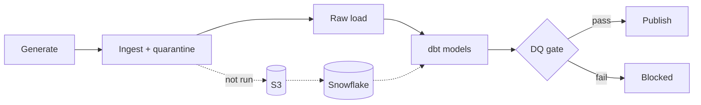

# CareLake

A healthcare analytics data platform built on **synthetic data**: simulated hospital source files are
ingested, validated, modelled and quality-gated before anything is published. It is a portfolio
project for learning a modern stack (AWS S3, Snowflake, dbt, Airflow); the parts that run today run
locally, and the cloud parts are written but **not yet executed** (see Status).

**Business problem it simulates:** hospital operations teams need trustworthy admissions, length-of-stay
and 30-day readmission figures, but source feeds arrive with duplicates, late and corrected records,
invalid codes, orphaned references and changing schemas. CareLake shows how to catch those problems,
keep rejected records visible, and refuse to publish when critical checks fail.


Solid = built and run locally. Dashed = written, never executed. Full detail: [docs/architecture.md](docs/architecture.md).

## Stack and why
| Tool | Role | Why |
|---|---|---|
| Python (stdlib-first) | generation, ingestion, DQ checks | few dependencies, easy to test |
| DuckDB | local stand-in warehouse | lets dbt and CI run free while no Snowflake account exists |
| dbt Core | staging, dimensional model, marts, tests | lineage, tests and docs as code |
| Airflow 3 | orchestration | retries, dependencies, run history; DQ failure blocks publish |
| GitHub Actions | CI | lint, tests, full DuckDB pipeline, no secrets |
| Snowflake, S3 | target platform | code and SQL written, not run |

## Results (all from real local runs, default seed)
- **Tests:** 20 pass (`pytest`), 92% line coverage; `ruff` clean. Only the Snowflake runner is untested, because it needs an account.
- **dbt:** `build` PASS=43, WARN=1, ERROR=0. The warning is the injected orphan encounter.
- **DQ gate:** 38 checks, 37 pass, 1 expected warning, decision PUBLISH. On deliberately corrupted data: 3 critical failures, BLOCKED, exit code 2.
- **Airflow (`dags test`):** normal run, repeat run with no new rows, a retried simulated failure, a DQ block, and a repair. See [docs/demo_walkthrough.md](docs/demo_walkthrough.md).

## Status

| Component | State |
|---|---|
| Deterministic generator (6 entities, 2 batches, injected anomalies) | Implemented, unit-tested locally |
| Local ingestion (validation, quarantine, manifest, idempotent rerun) | Implemented, unit-tested locally |
| Local raw loader (DuckDB, append-only, file-level idempotent) | Implemented, unit-tested locally |
| dbt project (6 staging views, 3 dims, 1 fact, orphan quarantine, 2 marts) on DuckDB | `dbt build`: PASS=43 WARN=1 ERROR=0 |
| dbt on Snowflake (`snowflake` target in `dbt/profiles.yml`) | Written, **never executed** |
| DQ framework (38 checks, JSON report, publish gate) | Implemented; unit-tested and run on local data; gate pass and block covered by an end-to-end test |
| GitHub Actions workflow (lint, tests, DuckDB pipeline) | Written; **never run on GitHub** (no remote yet). Its script was run locally |
| Airflow 3.3.2 DAG (retries, DQ gate, as-of backfill, run log) | Run locally via `airflow dags test`; no scheduler/UI/Docker run |
| S3 upload (dry run default), Snowflake RAW DDL/COPY/MERGE renderer, bootstrap SQL | Written; offline-tested only. **Never run against AWS or Snowflake; Snowflake syntax not checked against docs** |

No cloud integration has been executed.

## Run everything locally (no cloud access needed)

```bash
uv venv --python 3.13 && uv pip install -e ".[dev,local]"
source .venv/bin/activate && scripts/run_local_pipeline.sh
```

## Run step by step

```bash
uv venv --python 3.13 && uv pip install -e ".[dev]"
.venv/bin/python -m carelake.cli generate   # writes data/raw/<entity>/load_date=.../*.csv
.venv/bin/python -m carelake.cli ingest     # data/ingested, data/quarantine, data/manifest
.venv/bin/pytest && .venv/bin/ruff check .
```

## dbt on DuckDB (local)

DuckDB is a local stand-in so the models and tests run without Snowflake. Models use
`qualify`, which Snowflake also supports; `date_diff`, `interval 30 day` and `regexp_matches`
are DuckDB spellings and will need small changes for Snowflake (`datediff`, `dateadd`,
`regexp_like`).

```bash
uv pip install -e ".[dev,local]"
export CARELAKE_DATA_DIR=data
.venv/bin/python -m carelake.cli generate && .venv/bin/python -m carelake.cli ingest
.venv/bin/python -m carelake.cli load
cd dbt && ../.venv/bin/dbt build --profiles-dir .
```

Measured on the default seed (not a benchmark): ingest quarantined 4 rows; raw has 503 encounter
rows for 502 distinct ids (one corrected); fact has 501 encounters plus 1 orphan routed to
`quarantine_orphan_encounters`, which fires the one expected warning.

Known synthetic-data limitations visible in the marts: the generator assigns departments
independently of encounter class (so "Emergency" has inpatient stays), and 200 patients with random
re-visits produce high readmission rates (about 12-32%). These numbers demonstrate the logic, not
real clinical rates. Readmission definition is documented in `mart_readmission_rate.sql`.

## Orchestration (Airflow, local)

Airflow lives in its own virtualenv (`.venv-airflow`, see `dags/carelake_pipeline.py`); tasks call
the project venv via subprocess. Installed without Airflow's official constraints file (fine for a
local demo, not for production).

```bash
uv venv --python 3.13 .venv-airflow && uv pip install --python .venv-airflow/bin/python apache-airflow -e .
export AIRFLOW_HOME=$PWD/.airflow AIRFLOW__CORE__LOAD_EXAMPLES=False AIRFLOW__CORE__DAGS_FOLDER=$PWD/dags
.venv-airflow/bin/airflow db migrate && .venv-airflow/bin/airflow dags reserialize
.venv-airflow/bin/airflow dags test carelake_pipeline 2025-01-02 --conf '{"fail_once_task":"load"}'
```

Scenarios actually run (each task attempt is logged to `data/runs/run_log.jsonl`):

| Scenario | Result |
|---|---|
| Day 1 then day 2 (`process_date` limits ingestion) | all tasks succeeded, `publish` ran |
| Day 2 repeated | succeeded, no new rows loaded (file-hash idempotency) |
| `load` fails on attempt 1 (simulated) | marked `up_for_retry`, attempt 2 succeeded |
| 3 raw rows deleted before a run | `dbt_build` succeeded, `dq_gate` = `blocked_by_dq`, `publish` not run, no retry |
| Raw table repaired and rerun | gate passed, `publish` ran |

Typical task times on this laptop (single runs, not a benchmark): `dbt_build` about 6 s, others under 1 s.
The transient failure is injected by our own code, so it demonstrates the retry mechanism, not a real outage.

## Data quality gate

```bash
.venv/bin/python -m carelake.cli dq   # exit 0 = publish, exit 2 = blocked by a critical failure
```

Checks cover row counts, nulls, duplicate keys, referential integrity (orphans tolerated up to 1%
and reported as a warning, never dropped), schema consistency (new columns reported, missing ones
fail), timestamp order, ingestion-to-raw-to-staging-to-fact-to-mart reconciliation, and changes to
previously reported months. Reports: `data/sample/dq_report_passing.json` (37/38 pass, 1 expected
warning) and `data/sample/dq_report_blocked.json` (I deliberately duplicated a patient key and deleted
3 raw condition rows in a copy of the data: 3 critical failures, exit code 2). Task success and
data-quality success are separate: the command running is not the same as the data being publishable.

Not yet covered: the historical-stability check only compares against the previous run's snapshot
file, and the suite currently runs on DuckDB only.

## Injected anomalies (batch 2)

Late-arriving encounter, corrected encounter and patient, exact duplicate, invalid ICD-10 code,
null required field, end-before-start, orphan patient reference, new `discharge_disposition`
column. Ground truth is written to `anomalies.json`. Row-level defects are quarantined at
ingestion; the orphan reference is a cross-table check left to the warehouse/dbt layer.

All data is synthetic and FHIR-inspired only, not FHIR conformant.

## Security and cost
- No credentials, keys or real patient data in the repo or its git history (scanned). `.env.example` holds placeholders; `.env`, keys, DuckDB files and generated data are git-ignored.
- CI needs no secrets. Cloud steps are opt-in (`--execute`); everything defaults to dry run.
- Planned least-privilege IAM and Snowflake roles: [docs/aws_iam.md](docs/aws_iam.md), [snowflake/00_account_setup.sql](snowflake/00_account_setup.sql). Not applied.
- Cost controls designed for Snowflake: XSMALL warehouse, 60 s auto-suspend, resource monitor with a credit quota. Nothing has been provisioned and no charges have been incurred.

## Limitations and next steps
- Snowflake and S3 code has never run; Snowflake SQL was written from memory without checking the docs and will need fixes on first execution. Some DuckDB-specific functions in the dbt models need porting.
- CI workflow has not run on GitHub yet; Airflow was exercised with `dags test`, not the scheduler or UI.
- Synthetic data is simplistic (departments independent of encounter class, random re-visits), so the metrics prove the logic, not clinical reality. Not FHIR conformant.
- Dimensions keep only the current version (no history/SCD2); no incremental dbt models because data volume does not justify them.
- Next: run the cloud stages with a real account, add a GitHub remote, then optionally a read-only AI assistant over run logs and DQ reports.
