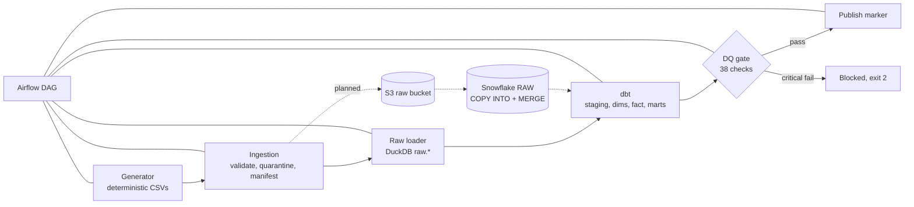

# Architecture

Solid boxes are implemented and were run locally. Dashed boxes are **planned and not built or run**.

## Layers

| Layer | Code | Responsibility |
|---|---|---|
| Source simulation | `src/carelake/data_generation` | Deterministic CSVs partitioned by `load_date`, plus `anomalies.json` ground truth |
| Ingestion | `src/carelake/ingestion` | Row validation, quarantine with reason codes, SHA-256 manifest for idempotency |
| Raw | `src/carelake/warehouse/local_loader.py` | Append-only `raw.<entity>` tables with `_source_file`, `_run_id`, `_loaded_at` |
| Transform | `dbt/` | Latest-version-wins staging, dimensional model, marts |
| Quality | `src/carelake/quality` | Reusable checks, JSON report, publish gate |
| Orchestration | `dags/`, `src/carelake/orchestration` | Task order, retries, run log |

## Local stand-in vs target platform

| Concern | Runs today | Target (not yet run) |
|---|---|---|
| Warehouse | DuckDB file | Snowflake (`RAW`, `STAGING`, `ANALYTICS` schemas) |
| Landing storage | local `data/` folders | S3 `raw/<entity>/load_date=YYYY-MM-DD/` |
| Load | Python append + file-hash skip | `COPY INTO` (load history) then `MERGE` |
| Orchestrator | `airflow dags test` | Airflow scheduler (local) |

Models use `qualify` (supported by both engines). A few functions are DuckDB spellings and need
changing for Snowflake: `date_diff`, `interval 30 day`, `regexp_matches`, `strftime`.
